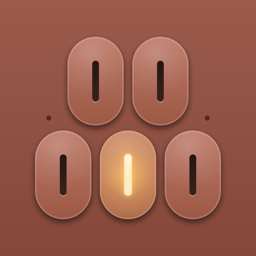
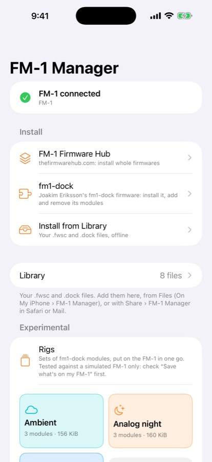
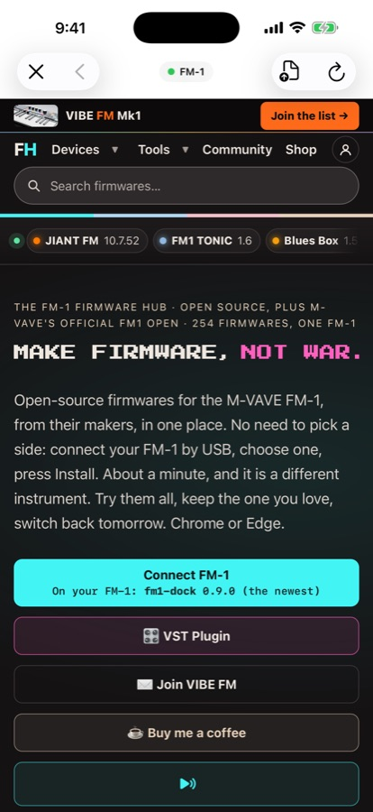
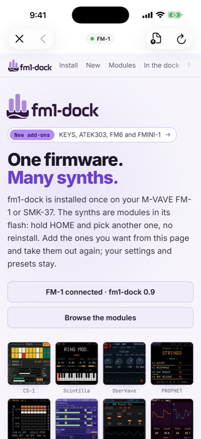
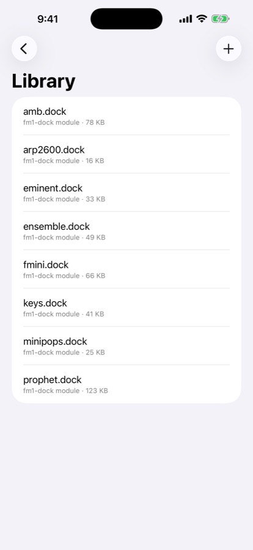
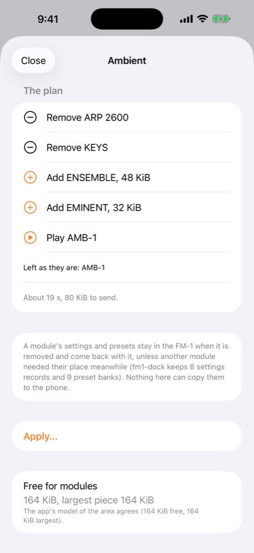
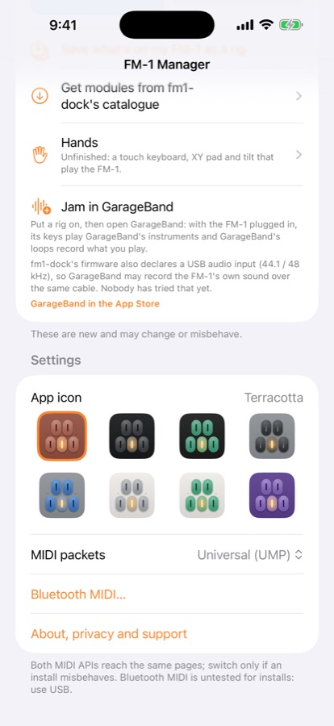

<p align="center">
  
</p>

<h1 align="center">Your FM-1, from your iPhone.</h1>

<p align="center">
  Install firmware and fm1-dock modules on an M-VAVE FM-1 with nothing but a phone and a USB cable.<br>
  Free, open source and unofficial. It collects nothing.
</p>

<!-- When TestFlight or the App Store has it, this line becomes the link to it. -->
<h3 align="center">
  <a href="#install-it-now">Install it now: build it with Xcode in five steps</a>
</h3>

<p align="center">
  iPhone · iOS 17 or later · a USB data cable to the FM-1 (USB-C, or Apple's camera adapter on a Lightning iPhone)<br>
  TestFlight and the App Store are on the way; this page will link them when they are real.<br>
  <a href="SUPPORT.md">Help and recovery</a> · <a href="PRIVACY.md">Privacy</a> · <a href="CHANGELOG.md">What's new</a> · <a href="CONTRIBUTING.md">Contributing</a>
</p>

<p align="center">
  <a href="https://github.com/KonradHerman/fm1-manager/actions/workflows/tests.yml"></a>
</p>

> [!WARNING]
> **This app writes firmware to your synth.** It has been used on one iPhone and one FM-1, and the one whole-firmware
> install tried from a phone failed and needed a computer to put right. Before you install a firmware, read
> [what to do if it goes wrong](SUPPORT.md#if-something-goes-wrong). Adding and removing fm1-dock modules is the
> gentler path; replacing the whole firmware is the risky one.

<p align="center">
  
</p>

## Web MIDI, where Safari has none.

The FM-1's installers are web pages that need Web MIDI, which Safari on the iPhone does not have. FM-1 Manager opens them as they
are and connects them to your FM-1 over the cable: the FM-1 Firmware Hub, fm1-dock's page and Baud Girl's installer.



## Modules without a computer.

fm1-dock turns the FM-1 into a host for many synths. Its own page runs here unchanged: install fm1-dock, then add
and remove its modules.



## A shelf for your files.

Keep .fwsc firmware and .dock modules on the phone, in the Files app or shared from Safari and Mail, and install
them offline.



## Swap whole sets of synths. (Experimental)

The FM-1 has room for only a few add-on modules at a time. A rig is a named set kept on the phone; putting it on
changes only what differs and checks the FM-1 after every step.



## Also in there

- **Update mode, explained.** If an install stops, the app recognises the FM-1's update mode and says what to do next.
- **Knows its chip.** It reads the FM-1's flash chip from fm1-dock, or asks, and opens the Hub filtered to firmwares that save on newer FM-1s.
- **Known problems.** The firmware problems we have seen ourselves, in the app and in [SUPPORT.md](SUPPORT.md).
- **Hands.** An unfinished touch keyboard, XY pad and tilt control that play the FM-1. (Experimental)
- **Eight colours.** App icons to match your FM-1, in Settings.
- **Backups land safely.** A file an installer saves, such as Baud Girl's preset backup, goes into your library.
- **Nothing phones home.** No account, no analytics, no tracking; see [PRIVACY.md](PRIVACY.md).

<p align="center">
  
</p>

## Honest status

Tried on hardware: **one iPhone and one FM-1** with the newer flash chip, running fm1-dock 0.9.0. Everything else has
run only against a simulated FM-1, in automated tests on a Mac and in the iOS simulator.

| Part | Details | Status |
| --- | --- | --- |
| FM-1 Firmware Hub and fm1-dock's page | Reported working on that phone and FM-1; exactly which operations was not recorded. | ~ Partly |
| fm1-dock modules | Add and remove through fm1-dock's page or the library; on hardware, not recorded. Simulated: every byte checked. | ~ Partly |
| Whole-firmware installs | One tried from a phone: Skiff 2.7 from the Hub stopped in its own update loader; the same from a Mac; recovered with M-Flasher. Simulated: 610 KiB installs, cut-offs and resumes. | ✗ Failed once |
| Newer-chip FM-1 (logo under the screen) | The unit above. | ~ Partly |
| Older-chip FM-1 | Never tried. | ✗ Not yet |
| Baud Girl's installer | Live page, simulated FM-1: it finds the FM-1 and offers the install; never run further. | ~ Partly |
| Rigs | Simulated FM-1 only, its module area modelled on fm1-dock's own code. | ✗ Not yet on hardware |
| Hands | Crashed on opening on a real iPhone in build 4; fixed in build 6, not yet confirmed. Feel and latency untested. | ~ Partly |
| Bluetooth MIDI | Pairing is there; installing over Bluetooth was never tried. Use USB. | ✗ No |
| iPad | Off for 1.0: nobody has tried it, and an App Store app can add iPad later but never take it away. | ✗ No |

<h3 align="center">
  <a href="#install-it-now">Install it now</a>
</h3>

<p align="center">
  It is unofficial: not made by or affiliated with M-VAVE, the FM-1 Firmware Hub, fm1-dock or Baud Girl.<br>
  Questions and problems go to <a href="https://github.com/KonradHerman/fm1-manager/issues">this repository's issues</a>, not to them.
</p>

## Standing on

This app is a thin layer over other people's work, and it would be nothing without it:

- **[fm1-dock](https://github.com/joakimeriksson/fm1-dock)** by Joakim Eriksson: the firmware, its page and the
  installer code the app carries.
- **[Felucca](https://github.com/hugelton/Felucca)** by Leo Kuroshita (Hügelton Instruments): the FM-1's open
  firmware and its update protocol, `fm1ota.js`.
- **[The FM-1 Firmware Hub](https://thefirmwarehub.com)**: every open FM-1 firmware in one place, with the installer
  the app opens.
- **[Baud Girl](https://baudgirl.com/work/FM-1+VA/)** by Madeline: FM-1+VA and its own installer.
- Every firmware author on the Hub, and M-VAVE for a synth that can be opened up like this.

---

# Build it yourself

## Install it now

Today the only way onto your phone is to build it. It takes about ten minutes the first time.

1. A Mac with **Xcode 26** (from the App Store) and **[XcodeGen](https://github.com/yonaskolb/XcodeGen)**:
   `brew install xcodegen`.
2. Get the code and make the Xcode project:
   ```sh
   git clone https://github.com/KonradHerman/fm1-manager.git && cd fm1-manager
   xcodegen
   ```
3. Make it yours. Add your Apple ID in Xcode › Settings › Accounts (a free one is enough; it gets a Personal Team).
   In `project.yml`, set `DEVELOPMENT_TEAM` to that team's ID (Xcode shows it in the target's Signing &
   Capabilities when you pick the team) and `PRODUCT_BUNDLE_IDENTIFIER` to a bundle id of your own, such as
   `com.yourname.fm1`. Run `xcodegen` again.
4. Plug in your iPhone, turn on Developer Mode (Settings › Privacy & Security › Developer Mode), open
   `FM1Dock.xcodeproj` and choose your iPhone at the top.
5. Press Run. The first time, trust your developer profile on the phone (Settings › General › VPN & Device
   Management).

With a free Apple ID the app stops opening after 7 days; press Run again to renew it.

## How it works

```
App/                 the iPhone app (SwiftUI): home, page view, library, Rigs, Hands, settings
  Resources/web/     fm1-dock's installer JavaScript (unmodified), the offline page and Rigs' page
  Resources/KnownProblems.json   firmware problems seen first-hand (format in App/Sources/KnownProblems.swift)
AppTests/            the app's tests, in the iOS simulator
FM1Kit/              the core as a Swift package that also builds on macOS
  Sources/FM1Kit/            CoreMIDI, the Web MIDI bridge, Rigs, Hands, the chip rules
  Sources/FM1KitTestSupport/ the simulated FM-1 and a web view harness
  Tests/FM1KitTests/         the core's tests, on a Mac
store/               the App Store text and screenshots
scripts/             screenshots.sh, testflight.sh
project.yml          the Xcode project's source (xcodegen); the generated project is not committed
```

- **Web MIDI for a web view.** `FM1Kit/Sources/FM1Kit/Resources/webmidi.js` is injected at document start into
  pages of an allow-list (`Site.midiOrigins` in `App/Sources/AppModel.swift`: thefirmwarehub.com,
  fm1.designburgapps.com, joakimeriksson.github.io, baudgirl.com and the app's own `fm1dock://app` pages). It gives
  them `navigator.requestMIDIAccess` with SysEx; any other site gets no MIDI at all. `WebMIDIBridge.swift` carries
  it to and from Swift.
- **CoreMIDI.** `MIDIEngine.swift` lists ports, connects inputs, sends through the UMP or the older packet-list API,
  and turns whatever packets arrive into whole messages (`MIDIStreamParser.swift`, `UMP.swift`): one event per SysEx.
- **The app's own pages** are served from the bundle under `fm1dock://app/` (`LocalSchemeHandler`), the library at
  `fm1dock://app/library/`.
- **DockLink** (`FM1Kit/Sources/FM1Kit/Rigs/DockLink.swift`) is the one place the app itself talks to fm1-dock on
  the device (Rigs, the flash chip). It runs fm1-dock's own `dock.js` in a hidden web view; a native version could
  replace it without touching the rest.
- **The rig planner** (`RigPlanner.swift`) is a pure function: device state, rig and library in, steps or a reason
  out. It models the module area as fm1-dock's `dock.c` does and checks its model against the device before it plans.
- **Hands** (`FM1Kit/Sources/FM1Kit/Hands.swift`) sends straight from the touch handlers to CoreMIDI, limits each
  control to 200 messages a second, and lets every note go on cancel, leaving, backgrounding and unplugging.
- **The flash chip** (`FlashChip.swift`): read from fm1-dock's INFO, or asked; the Hub's own `#newchip` filter.

What fm1-dock's flash can and cannot do, found while building Rigs: a module cannot be read back off the FM-1, so
keep its file; a module's settings and presets stay in flash when it is removed and come back with it, unless another
module needed their slot meanwhile (8 settings records, 9 preset banks), and nothing over USB copies them out.

## The FM1_DOCK switch

`FM1_DOCK` in `project.yml` decides whether fm1-dock's own code goes into the app. `YES` (the default, and what
ships) has fm1-dock's page, the library, Install from Library and Rigs, and carries fm1-dock's JavaScript. `NO` is the
hub-only app: the Firmware Hub, Baud Girl's installer and Hands, with none of fm1-dock's files. Change it in
`project.yml`, or pass `FM1_DOCK=NO` to `xcodebuild` for one build.

## Tests

The tests talk only to virtual MIDI endpoints they create, so they are safe with a real FM-1 plugged into the Mac.
Some load the live sites; `FM1_OFFLINE=1` skips those. A few use fm1-dock's published files and skip without a
checkout of it (`FM1_DOCK_DOCS=/path/to/fm1-dock/docs`).

```sh
cd FM1Kit && FM1_OFFLINE=1 swift test        # the core, on a Mac

# the app, in the iOS simulator, in both configurations
xcodebuild -project FM1Dock.xcodeproj -scheme FM1Dock -destination 'platform=iOS Simulator,name=iPhone 17 Pro' test
xcodebuild -project FM1Dock.xcodeproj -scheme FM1Dock -destination 'platform=iOS Simulator,name=iPhone 17 Pro' FM1_DOCK=NO test
```

## The simulated FM-1 and the demo

`FakeFM1` (`FM1Kit/Sources/FM1KitTestSupport/FakeFM1.swift`) answers on virtual endpoints as an FM-1 does: the
updater's handshake and reads, fm1-dock's commands and INFO, its module area placed as `dock.c` places it, and on
request a loader that drops out mid-write. Debug builds compile it into the app for the screenshots:
`scripts/screenshots.sh` launches the app with `-FM1Demo` (`App/Sources/DemoMode.swift`), which attaches a
simulated FM-1 that the app's MIDI engine sees alone. Release builds leave all of it out.

## Licence

FM-1 Manager is free software under the [GNU General Public License, version 3 only](LICENSE) (`GPL-3.0-only`); every
source file says so. It includes, unmodified, files from projects under the same licence:
`App/Resources/web/dock.js`, `install/fm1install.js` and `install/ports.js` from fm1-dock (Joakim Eriksson), and
`install/fm1ota.js`, Felucca's update protocol (Copyright (C) 2026 Leo Kuroshita, Hügelton Instruments), as fm1-dock
carries it. The simulated FM-1 is written after fm1-dock's `demo.js`, `dock.js`, `fm1ota.js` and `dock.c`; the
pattern that recognises an FM-1's port after fm1-dock's `ports.js` and the Firmware Hub's list. Whether fm1-dock's
files may go through Apple's App Store is being discussed with their authors; `FM1_DOCK=NO` leaves them out.
The installer sites are loaded from their own servers at run time and are not part of this repository.
